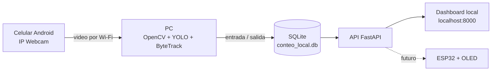

<div align="center">

# 🛍️ Cámara Shopping

### Conteo anónimo de personas con una cámara IP y un dashboard local

**Un celular Android transmite video. La PC detecta cruces, actualiza el aforo y guarda cada evento en SQLite.**


</div>

---

## ¿Qué hace?

Cámara Shopping es un prototipo académico para estimar cuántas personas entran y salen de un local. Usa **IP Webcam** en Android como fuente de video y ejecuta la detección en una computadora con Python.

Cuando una persona cruza la línea virtual de la cámara, el sistema registra el tipo de cruce, la hora y el aforo resultante. El dashboard muestra el aforo actual, entradas y salidas del día, movimiento por hora y los últimos eventos.



## Funciones

- Detecta personas y les asigna un ID temporal para seguirlas entre cuadros.
- Cuenta cruces en ambas direcciones con una banda de histéresis para reducir duplicados.
- Conserva el aforo en SQLite entre reinicios y limita el conteo de salidas para que no sea negativo.
- Vuelve a intentar la conexión si se corta el video.
- Ofrece un dashboard que se actualiza automáticamente y una API lista para consultar desde otro dispositivo.
- Incluye modo de datos de demostración para probar la interfaz sin conectar la cámara.

## Requisitos

- Windows 10/11 y Python de 64 bits. Python 3.11 o posterior es una buena opción.
- Un celular Android con [IP Webcam](https://play.google.com/store/apps/details?id=com.pas.webcam).
- PC y celular conectados a la misma red Wi-Fi.
- Conexión a internet durante la primera instalación para instalar paquetes y descargar el modelo YOLO nano.

## Puesta en marcha en Windows

Abrí **PowerShell** en la carpeta del proyecto. No hace falta activar el entorno virtual: usar su `python.exe` directamente también evita el bloqueo de scripts de PowerShell.

```powershell
cd "C:\ruta\a\TP2_Seminario"
py -3 -m venv .venv
.\.venv\Scripts\python.exe -m pip install --upgrade pip
.\.venv\Scripts\python.exe -m pip install -r requirements.txt
.\.venv\Scripts\python.exe init_db.py
```

La primera instalación puede tardar porque OpenCV y PyTorch son dependencias grandes. El modelo `yolov8n.pt` se descarga automáticamente la primera vez que arranca el tracker.

## Conectar el celular

1. Conectá la PC y el celular a la misma Wi-Fi.
2. Abrí **IP Webcam** en el celular y tocá **Iniciar servidor**.
3. La aplicación mostrará una dirección parecida a `http://192.168.0.158:8080`. La IP puede cambiar al conectarse a otra red.
4. Abrí esa dirección en el navegador de la PC. Si aparece la página de IP Webcam, hay conexión entre los dispositivos.
5. Para el tracker, agregá `/video` al final de la dirección.

Por ejemplo, si IP Webcam muestra `http://192.168.0.158:8080`, ejecutá:

```powershell
.\.venv\Scripts\python.exe tracker.py --source "http://192.168.0.158:8080/video"
```

La URL necesita `:` entre la IP y el puerto, y debe terminar en `/video`. No uses solamente `/`: esa ruta abre la página de IP Webcam, no el video que procesa el tracker.

### Sentido de entrada

Por defecto, el sistema considera que una entrada se mueve hacia abajo en la imagen. Si la cámara está orientada de manera que la entrada se ve hacia arriba, agregá `--up-is-in`:

```powershell
.\.venv\Scripts\python.exe tracker.py --source "http://192.168.0.158:8080/video" --up-is-in
```

Ubicá el celular firme, apuntando al paso, y comprobá en la ventana de vista previa que la línea roja cruce el umbral. La tecla `Q` cierra la vista y detiene el tracker.

## Abrir el dashboard

Dejá el tracker corriendo y abrí **otra ventana de PowerShell** en la carpeta del proyecto. Iniciá la API y el dashboard:

```powershell
.\.venv\Scripts\python.exe -m uvicorn api:app --host 0.0.0.0 --port 8000
```

En la PC, abrí <http://localhost:8000>. Los dos procesos deben seguir activos: el tracker procesa la cámara y Uvicorn sirve el dashboard.

### Probar el dashboard sin cámara

```powershell
.\.venv\Scripts\python.exe init_db.py --demo
```

Esto agrega algunos eventos de muestra a la base. Para vaciar los eventos intencionalmente y empezar de cero:

```powershell
.\.venv\Scripts\python.exe init_db.py --reset
```

`init_db.py` sin opciones sólo inicializa o actualiza el esquema; no borra los registros existentes.

## API disponible

Con el servidor iniciado, estos endpoints entregan JSON:

| Ruta | Para qué sirve |
| --- | --- |
| `GET /api/resumen` | Aforo, entradas y salidas de hoy, capacidad configurada y estado del tracker. |
| `GET /api/aforo` | Resumen compacto para la futura ESP32 con pantalla OLED. |
| `GET /api/eventos?limit=30` | Últimos eventos registrados. |
| `GET /api/series/hora` | Entradas y salidas agrupadas por hora. |
| `GET /api/series/dias?dias=7` | Resumen diario del período solicitado. |
| `GET /health` | Estado de la API y de la base de datos. |

La capacidad máxima predeterminada es 30 personas y se configura en `api.py`.

## ¿Qué guarda la base?

El archivo `conteo_local.db` se crea localmente y no necesita un servidor de base externo.

Cada evento contiene:

- fecha y hora local;
- tipo: `IN`, `OUT` o `RESET`;
- aforo resultante;
- ID temporal del seguimiento y confianza de detección, si corresponden;
- fuente del evento.

El sistema no guarda capturas, grabaciones, rostros, nombres ni un identificador permanente de las personas. La cámara procesa video en vivo para detectar cruces; el dashboard sólo recibe métricas y eventos.

## Ajustes del conteo

El tracker acepta opciones para calibrar la línea, la banda de tolerancia, el tamaño del cuadro y el umbral de confianza:

```powershell
.\.venv\Scripts\python.exe tracker.py --help
```

Valores predeterminados: cuadro de `640 × 480`, línea horizontal en `--line-y 240`, banda de `--offset 25` píxeles y umbral de detección `--confidence 0.35`. Para procesar sin abrir la ventana de video, agregá `--no-preview`.

## Problemas comunes

| Síntoma | Qué revisar |
| --- | --- |
| PowerShell dice que la ejecución de scripts está deshabilitada | No actives el entorno. Usá `.\.venv\Scripts\python.exe` al comienzo de los comandos, como en esta guía. |
| `localhost:8000` no abre | Iniciá Uvicorn en una segunda terminal y dejala abierta. El tracker por sí solo no levanta el dashboard. |
| `localhost:8000` muestra “sin conexión” | Confirmá que el proceso Uvicorn siga activo y que el puerto sea `8000`. |
| El tracker reintenta pero no abre la cámara | Verificá que IP Webcam siga transmitiendo, que celular y PC estén en la misma Wi-Fi y que la URL termine en `:PUERTO/video`. |
| Aparece `Failed to resolve hostname` | Revisá que entre la IP y el puerto haya dos puntos; por ejemplo `192.168.0.158:8080`. |
| Se ve la página de IP Webcam, pero no el video en el tracker | Usá la ruta `/video`, no la ruta raíz `/`. |
| Las entradas aparecen como salidas | Cambiá la orientación de la cámara o iniciá el tracker con `--up-is-in`. |

## Límites del prototipo

El resultado es una **estimación**, no un sistema de seguridad ni un conteo infalible. Oclusiones, contraluz, una cámara que se mueve, varias personas cruzando juntas o una ubicación inadecuada pueden generar omisiones o dobles conteos. Conviene hacer pruebas con un número conocido de cruces y ajustar el encuadre antes de presentar los resultados.

## Estructura del proyecto

```text
TP2_Seminario/
├── api.py              # API FastAPI y página del dashboard
├── counter.py          # Lógica de cruces de línea
├── dashboard.html      # Interfaz web
├── db.py               # SQLite, eventos, aforo y resúmenes
├── init_db.py          # Inicialización, demo y reinicio explícito
├── tracker.py          # IP Webcam, YOLO y ByteTrack
├── requirements.txt    # Dependencias
└── tests/              # Pruebas de conteo, base y API
```

## Contenido del repositorio

Este repositorio incluye el tracker, el dashboard, la API, la lógica de conteo, la base SQLite inicializable y las pruebas automatizadas. La base de datos con eventos reales se genera localmente al ejecutar el proyecto y no se versiona.

---

<div align="center">

Hecho como trabajo práctico de clase · Visión por computadora · Conteo anónimo de aforo

</div>
